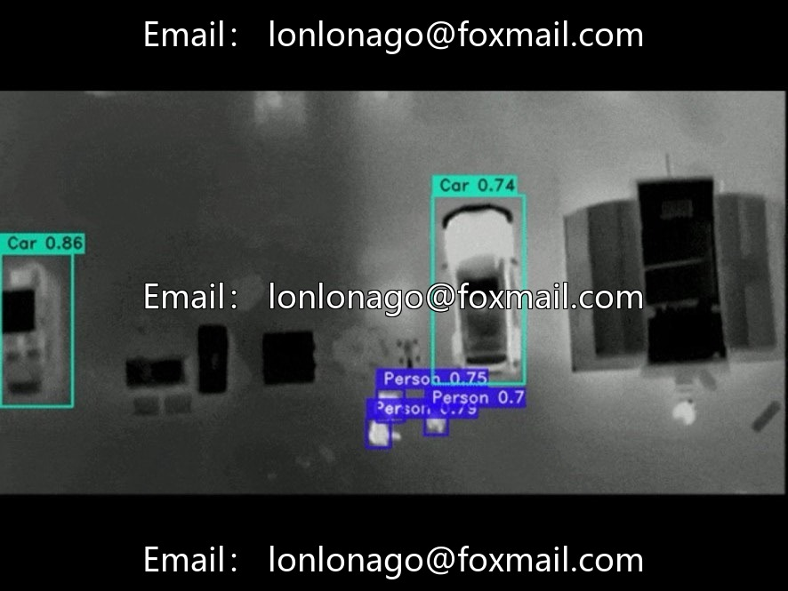
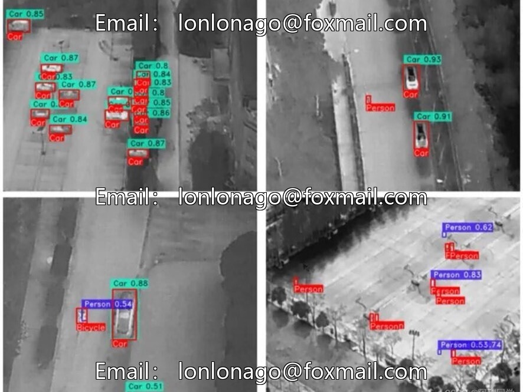
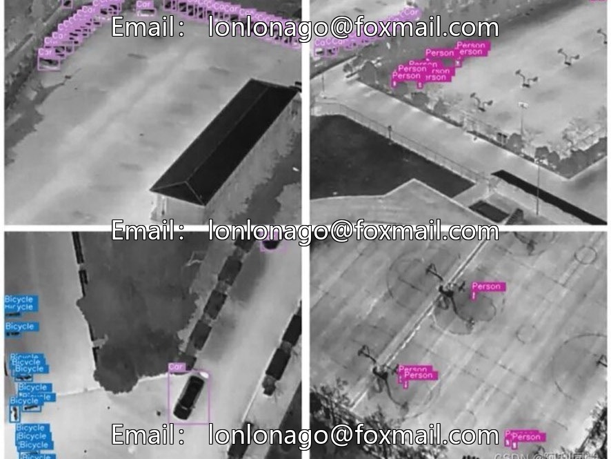
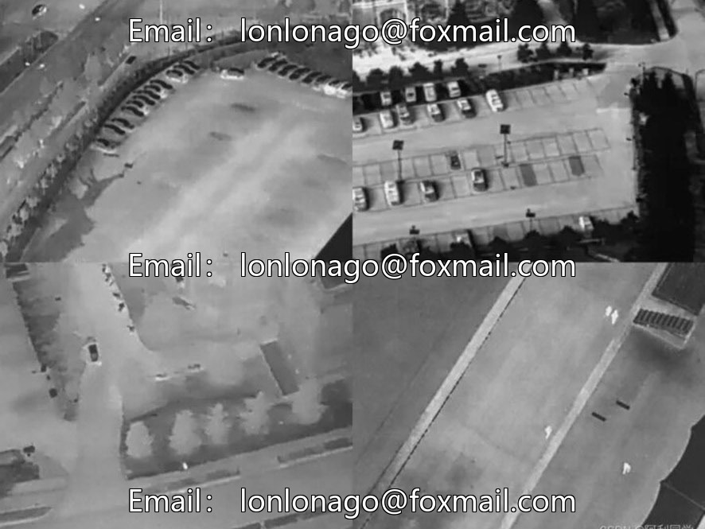

# Infrared UAV Human-Vehicle Detection Dataset, Issue 10013, Specially Designed for Drone Aerial Photography, Focused on

## Body

Infrared UAV Human-Vehicle Detection Dataset, Issue 10013, designed for drone aerial photography, focusing on the recognition of pedestrians and vehicles, suitable for low-altitude inspection, security monitoring model training, and algorithm testing.

The dataset consists of over 1000 infrared aerial images, with 10 categories of targets (mainly pedestrians, vehicles, and drones), at resolutions of 1080p and 4K. It supports horizontal bounding box + rotational bounding box annotation, compatible with three mainstream formats: VOC, COCO, and YOLO. It is ready to use out of the box.

Small target proportion (80% of the target size is less than 80×80 pixels), rich scenes, covering urban areas, farmlands, highways and so on, complex working conditions (strong light, haze, obstruction) full coverage, multi-scale targets, realization of aerial photography visual effect.

Suitable for drone security inspection, traffic monitoring, infrared vision algorithm research and development, academic experiments, etc.

Virtual materials, once sold, are non-refundable.
Interested friends, click "I want" to proceed.

## Images

## Payment

Here is a pay link on Stripe ( https://buy.stripe.com/3cs8yP7sY87d0vu9AB ). Please contact me lonlonago@foxmail.com after funding $89, and I will send you a complete data files , thank you!

